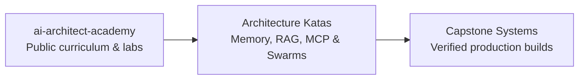

# AI Architect Academy

Hands-on AI architecture labs, system design tracks, and operator training built with coding agents.

**Website:** [frankx.ai/academy](https://frankx.ai/academy) · **Ecosystem:** [Starlight Intelligence](https://github.com/Starlight-Intelligence) · [Starlight Systems](https://github.com/Starlight-Intelligence-Systems) · [Arcanea Labs](https://github.com/Arcanea-Labs) · [GenCreator](https://github.com/GenCreator-ai) · [FrankX](https://github.com/FrankX-AI)

---

## Overview

AI Architect Academy provides structured learning tracks, architecture kata labs, and capstone blueprints for engineers learning to design and operate production AI systems with coding agents.

## System topology



## Flagship repositories

| Repository | Purpose | Link |
| :--- | :--- | :--- |
| [**ai-architect-academy**](https://github.com/AI-Architect-Academy/ai-architect-academy) | Learn AI architecture by building real systems with coding agents: labs, rubrics, and reference blueprints. | [Website](https://frankx.ai/academy) |

## Quickstart

```bash
# Clone the AI Architect Academy lab repository
git clone https://github.com/AI-Architect-Academy/ai-architect-academy.git
cd ai-architect-academy
```

## Engineering standards

Every repository in **AI Architect Academy** follows the Starlight estate engineering contract:

1. **Draft-first pull requests**: Open pull requests in draft mode (`gh pr create --draft`). CI workflows run only when a pull request is marked ready for review or lands on `main`.
2. **Independent verification**: Maker harness and Checker harness must differ (`Maker-Harness` != `Checker-Harness`).
3. **Zero committed secrets**: Credentials live in local environment files or Infisical. Pre-commit and CI gates reject secret patterns.
4. **Editorial clarity**: Public documentation uses sentence case headings, concrete verbs, and verified metrics.

---

<sub>Maintained by <a href="https://github.com/frankxai">Frank Riemer (frankxai)</a> · Built on the <a href="https://github.com/Starlight-Intelligence-Systems/Starlight-Intelligence-System">Starlight Intelligence Protocol (SIP)</a></sub>
